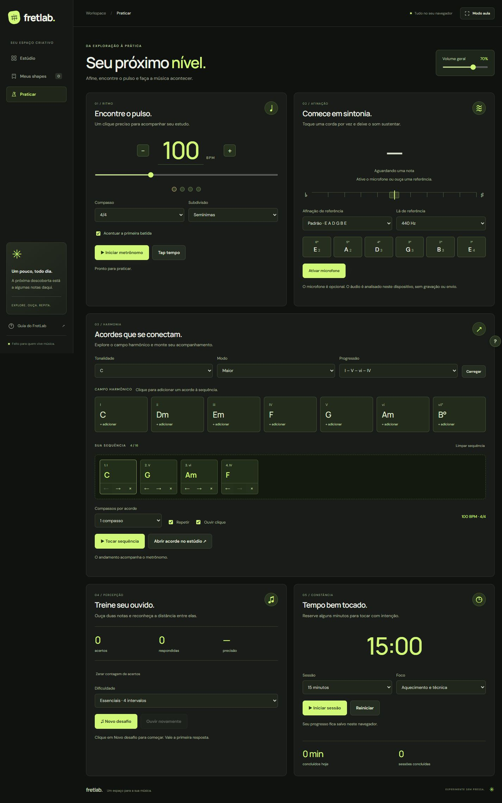

# FretLab

Seu laboratório de guitarra. Explore o braço, descubra acordes e escalas e transforme suas ideias em materiais para aulas.

[Abrir o estúdio](https://lucaruch.github.io/FratLab/)


## A nova interface

- Identidade visual em grafite e verde-lima, com tônicas em âmbar.
- Navegação lateral no desktop e navegação compacta em tablets e celulares.
- Braço interativo em destaque, com análise harmônica ao lado e rolagem própria em telas pequenas.
- Biblioteca com diagramas de acordes e escalas e indicação do shape selecionado.
- Caderno de aula, rascunhos locais e exportação em PNG/PDF.
- Foco visível, navegação por teclado, nomes acessíveis e respeito à preferência por movimento reduzido.

HTML, CSS e JavaScript puros. Sem instalação, compilação ou dependências de execução. As fontes do Google Fonts são opcionais: a interface usa fontes de sistema quando estiverem indisponíveis.

## Recursos

- Seleção de notas em até 24 casas, com nomes e destaque para a tônica.
- Modos de exploração, acordes e escalas; afinações alternativas e orientação para canhotos.
- Identificação de acordes, inversões e escalas, distinguindo correspondências exatas de escalas compatíveis.
- Reprodução sonora sintetizada, transposição e exemplos musicais.
- Shapes e rascunhos salvos no navegador.
- Exportação de PNG e PDF com nome do aluno e anotações opcionais.
- Metrônomo de 40–240 BPM, tap tempo, compassos de 2 a 7 tempos e quatro subdivisões.
- Afinador cromático com microfone opcional e sons de referência em cinco afinações, calibrados em 432, 440 ou 442 Hz.
- Campo harmônico maior e menor natural, progressões prontas e sequência editável de até 16 acordes.
- Acompanhamento sintetizado em loop, com andamento compartilhado, clique opcional e escolha de compassos por acorde.
- Treino de ouvido com 4 ou 12 intervalos, repetição do áudio e estatísticas da primeira resposta.
- Timer de 5 a 30 minutos, pausa, foco de estudo e histórico de sessões concluídas.
- Busca por título, aluno ou anotação, ordenação, favoritos, duplicação e backup JSON da coleção.

## Praticar

Abra [a área Praticar](https://lucaruch.github.io/FratLab/#praticar) pelo menu lateral. O metrônomo pode acompanhar o braço no Estúdio: uma barra flutuante permite pará-lo de qualquer tela. **Esc** interrompe os sons e desliga o microfone. A reprodução pausa ao sair da aba; o timer de estudo continua contando pelo relógio.

No campo harmônico, clique em um grau para acrescentar o acorde. Reordene ou remova os blocos da sequência, escolha um bloco e use **Abrir acorde no estúdio** para explorar uma digitação. As progressões são tríades diatônicas; o modo menor usa a escala menor natural.

O afinador começa com o microfone desligado. Para medir uma nota, clique em **Ativar microfone** e permita o acesso. A análise acontece no dispositivo: não há gravação ou envio de áudio. Sair da área Praticar, trocar de aba ou pressionar Esc desliga a captura. As cordas de referência funcionam sem microfone.

O treino de ouvido usa intervalos ascendentes. Apenas a primeira resposta conta; ouvir novamente não reduz a pontuação. O timer registra sessões inteiras concluídas; recarregar a página encerra uma sessão ainda em andamento.



## Backup e dados

Em **Meus shapes**, exporte um **Backup JSON** para guardar ou transferir sua coleção. **Importar** valida o arquivo inteiro antes de salvar: shapes com o mesmo identificador são ignorados e os atuais são preservados. O limite é de 500 shapes e arquivos de até 2 MB. O backup inclui os shapes e suas anotações; preferências, sequência, estatísticas e rascunho atual continuam locais.

## Executar localmente

Não é necessário instalar dependências para usar o aplicativo. Com Python 3 instalado, execute na pasta do projeto:

```sh
python -m http.server 8000 --directory dist
```

Abra `http://localhost:8000` no navegador.

## Publicar no GitHub Pages

Em **Settings → Pages → Build and deployment → Source**, selecione **GitHub Actions**. O fluxo `.github/workflows/pages.yml` verifica o JavaScript e a análise musical e publica a pasta `dist` após envios à branch `main` ou `master`. Ele também pode ser iniciado manualmente pela aba **Actions**.

O site usa caminhos relativos e pode ser hospedado no subdiretório do repositório.

## Verificações

Com Node.js 22:

```sh
node tests/music.cjs
node tests/practice.cjs
node tests/tools.cjs
node --check dist/app.js
node --check dist/music.js
node --check dist/practice.js
node --check dist/tools.js
```

São **713 verificações**: 461 do motor musical, 228 de campo harmônico/detecção de frequência/backup e 24 de integração para o agendamento de áudio, liberação do microfone, conclusão do timer e falha de armazenamento. O CI executa essas verificações antes de publicar.

A revisão no navegador cobre layout responsivo, biblioteca, restauração e rejeição de backups, metrônomo, progressões, referências sonoras, treino de ouvido, timer e as funções anteriores do estúdio. O detector foi validado com sinais sintetizados em 44,1 e 48 kHz, incluindo harmônicos; a captura usa streams simulados nos testes. A precisão com guitarra e microfone reais precisa ser conferida no dispositivo usado para tocar.

Referências técnicas: [permissão de microfone](https://developer.mozilla.org/en-US/docs/Web/API/MediaDevices/getUserMedia), [amostras de áudio](https://developer.mozilla.org/en-US/docs/Web/API/AnalyserNode/getFloatTimeDomainData) e [relógio do Web Audio](https://developer.mozilla.org/en-US/docs/Web/API/BaseAudioContext/currentTime).

## Dados dos alunos

Os shapes, rascunhos e anotações são mantidos no armazenamento local do navegador. Os materiais exportados são gerados no próprio dispositivo. A coleção não é sincronizada entre dispositivos.

## Créditos

Esta versão é uma cópia com redesign do [FratLab de misaelmarx](https://github.com/misaelmarx/FratLab). O histórico e o motor original de análise musical foram preservados.
