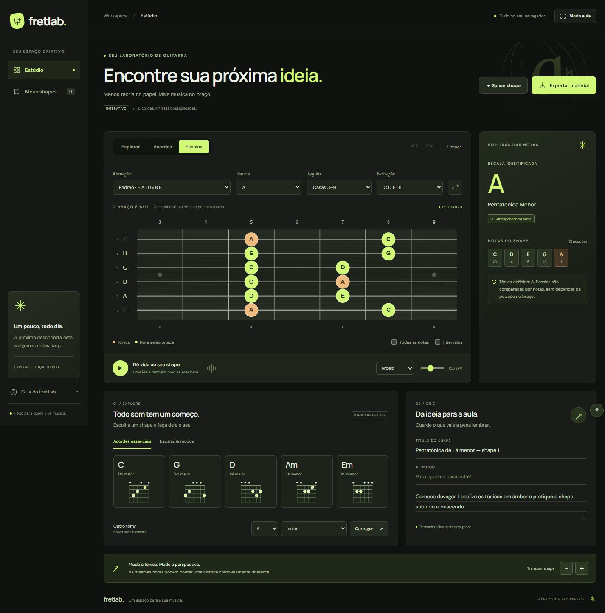

# FretLab

Seu laboratório de guitarra. Explore o braço, descubra acordes e escalas e transforme suas ideias em materiais para aulas.

[Abrir o estúdio](https://lucaruch.github.io/FratLab/)



## A nova interface

- Identidade visual em grafite e verde-lima, com tônicas em âmbar.
- Navegação lateral no desktop e navegação compacta em tablets e celulares.
- Braço interativo em destaque, com análise harmônica ao lado e rolagem própria em telas pequenas.
- Biblioteca com diagramas de acordes e escalas e indicação do shape selecionado.
- Caderno de aula, rascunhos locais e exportação em PNG/PDF.
- Foco visível, navegação por teclado, nomes acessíveis e respeito à preferência por movimento reduzido.

HTML, CSS e JavaScript puros. Sem instalação, compilação ou dependências de execução. As fontes do Google Fonts são opcionais: a interface usa fontes de sistema quando estiverem indisponíveis.

## Recursos

- Seleção de notas em até 24 casas, com nomes e destaque para a tônica.
- Modos de exploração, acordes e escalas; afinações alternativas e orientação para canhotos.
- Identificação de acordes, inversões e escalas, distinguindo correspondências exatas de escalas compatíveis.
- Reprodução sonora sintetizada, transposição e exemplos musicais.
- Shapes e rascunhos salvos no navegador.
- Exportação de PNG e PDF com nome do aluno e anotações opcionais.

## Executar localmente

Não é necessário instalar dependências para usar o aplicativo. Com Python 3 instalado, execute na pasta do projeto:

```sh
python -m http.server 8000 --directory dist
```

Abra `http://localhost:8000` no navegador.

## Publicar no GitHub Pages

Em **Settings → Pages → Build and deployment → Source**, selecione **GitHub Actions**. O fluxo `.github/workflows/pages.yml` verifica o JavaScript e a análise musical e publica a pasta `dist` após envios à branch `main` ou `master`. Ele também pode ser iniciado manualmente pela aba **Actions**.

O site usa caminhos relativos e pode ser hospedado no subdiretório do repositório.

## Verificar a análise musical

Com Node.js 22:

```sh
node tests/music.cjs

Para verificar também a sintaxe:

    node --check dist/app.js
    node --check dist/music.js

O teste musical cobre 461 verificações. A revisão da interface incluiu larguras de 320, 390, 768, 1024 e 1440 pixels, seleção pelo teclado, acordes e escalas, gerador, transposição, afinação alternativa, canhotos, desfazer/refazer, persistência, exclusão/restauração, reprodução, modo aula e download de PNG/PDF.
```

## Dados dos alunos

Os shapes, rascunhos e anotações são mantidos no armazenamento local do navegador. Os materiais exportados são gerados no próprio dispositivo. A coleção não é sincronizada entre dispositivos.

## Créditos

Esta versão é uma cópia com redesign do [FratLab de misaelmarx](https://github.com/misaelmarx/FratLab). O histórico e o motor original de análise musical foram preservados.
